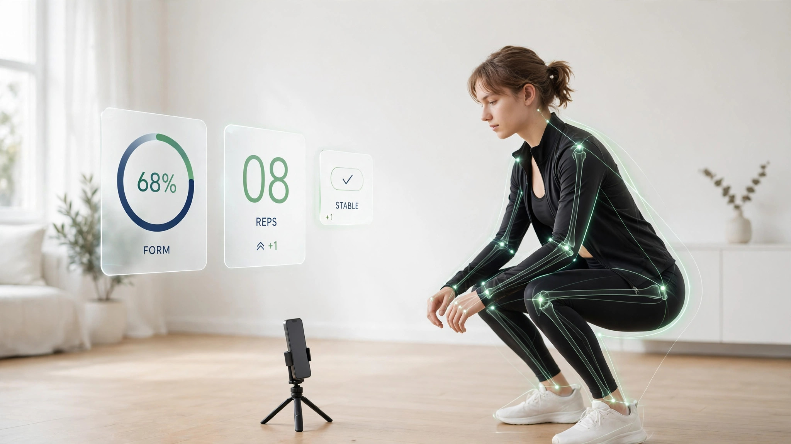
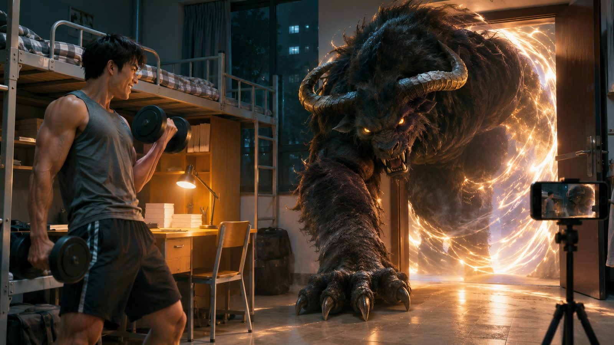
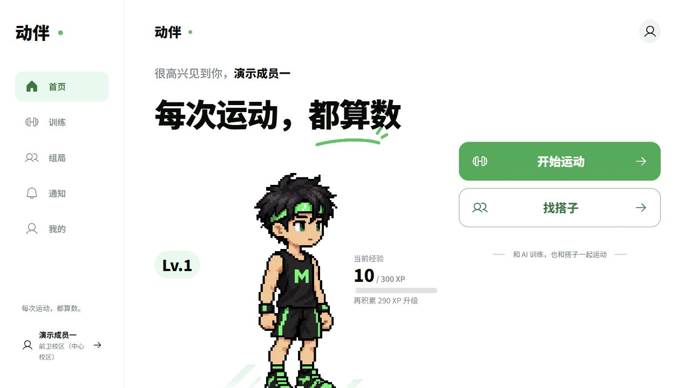
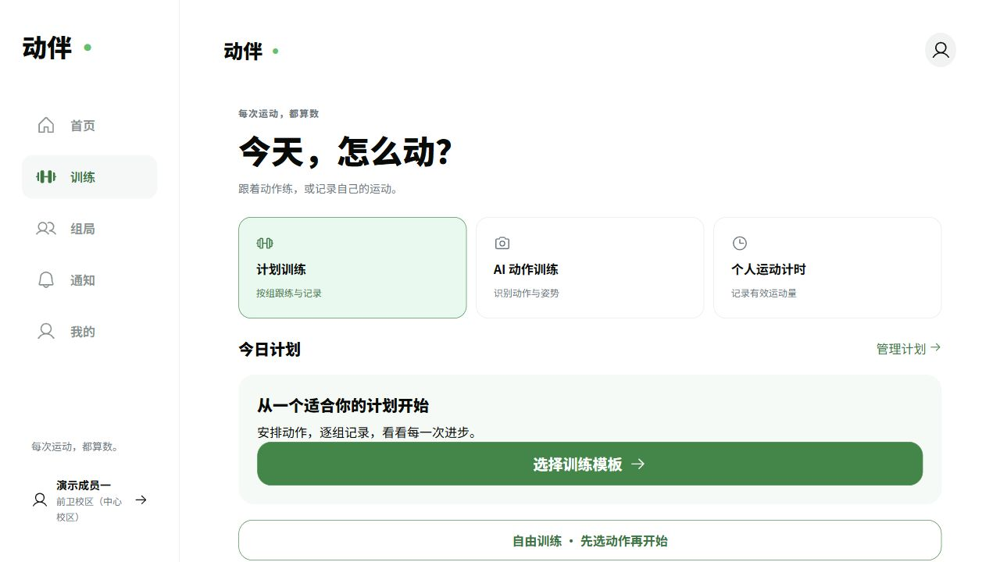
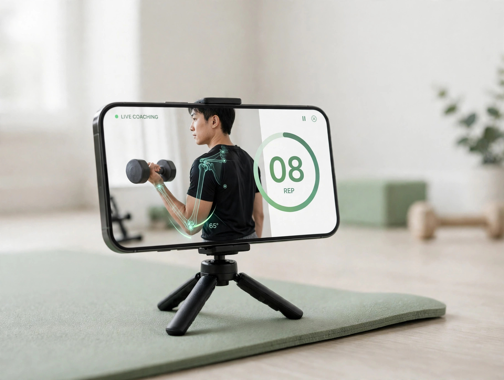
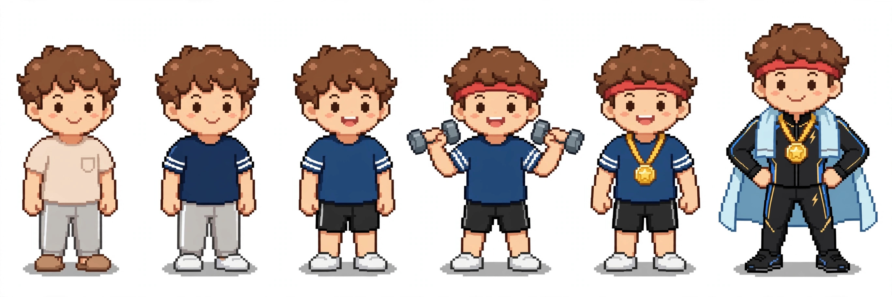
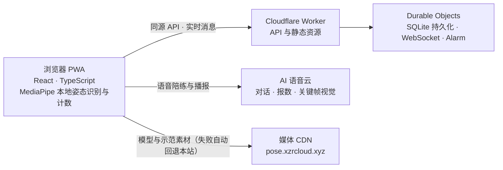

<div align="center">

# MoveMate · 动伴

**每次运动，都算数。**

手机架起来，摄像头就是你的教练，AI 陪练在耳边报数——怪兽还会闯进你的房间，等你和朋友一起把它打回去。训练计划、AI 动作计数、AI 语音陪练、找搭子与组队打怪，全装进一个校园运动社区。

[在线体验](https://dongban.xyz) · [开发指南](docs/development.md) · [文档中心](docs/README.md) · [反馈问题](https://github.com/xuzerui6/MoveMate/issues/new/choose)

[](https://github.com/xuzerui6/MoveMate/actions/workflows/ci.yml)


[](LICENSE)

</div>



<div align="center">

| 动作库条目 | 图文完整 | 照片示范 | 摄像头识别动作 |
| :---: | :---: | :---: | :---: |
| **1,329** | **1,064** | **1,058** | **56** |

</div>

## 产品亮点

- **AI 动作计数**：56 个动作，开摄像头就能练。姿态识别与计数全在手机本地实时完成，视频一步都不上传。
- **AI 语音陪练**：不是机械播报，是全程能聊的陪练——它看得见你的动作，报数、给指导、累了给你打气，陪你练完一组又一组。
- **组队打怪**：怪兽压进房间，你的每一次真实动作都是伤害。约上朋友多人同屏开打：健身靠真次数打伤害，其他运动按约定一段段推进。
- **能换装的分身**：发型、眼镜、衣服等七个部位自由搭配，部件靠训练和打怪解锁，不花钱。
- **校园组局**：13 类运动发局找搭子，局只在本校内可见；吉林大学已开放注册，吉林体育学院内测中。

## 组队打怪：怪兽，进了你的房间



<div align="center">

*概念渲染：宿舍门被推开的那一秒，今晚的训练就不再是一个人的事。*

</div>

这不是贴纸小游戏——怪兽的血量，要靠你和队友的真实运动一点点打掉。健身动作开摄像头真计数，每一次标准动作都换算成伤害；篮球、跑步、游泳等其他运动，按各品类的「完成约定」分段推进，全队一起把进度打满。多人同屏、同一只怪、同一个目标：没打完，怪会逃走；打赢了，全队拿下首胜纪念——每人只此一次。

## 产品能力

MoveMate 整合「动伴」的运动陪练、成长形象和「搭个局」的校园活动，使用统一账号、通知与数据库。手机保留五项底部导航，电脑使用侧栏与宽屏布局。

| 模块 | 可以做什么 |
| --- | --- |
| AI 动作训练 | 56 个摄像头动作：深蹲、开合跳、高抬腿、俯卧撑 4 种正式支持，其余 52 种为试用；计数全在设备本地实时完成，评分与提示用来帮你调整动作 |
| AI 语音陪练 | 全部语音由 AI 语音陪练发出：训练时是全程能对话的陪练——报数、看关键帧给指导和鼓励；组队打怪时负责播报节点。语音服务不可用时改走音效与屏幕提示，训练不中断 |
| 智能复核 | 摄像头训练默认开启：AI 陪练会看关键帧帮你复核动作，本站不保存图片 |
| 计划与自由训练 | 动作库、可编辑模板、周计划／循环安排、逐组重量与次数、组间休息、暂停及刷新恢复；计划内的组也能开摄像头计数 |
| 组队打怪 | 和朋友组局一起打怪：健身动作按真实计数打伤害；篮球、跑步、游泳等其他运动按各类目的「完成约定」一段段推进，没打完怪会逃走；赢了有首胜纪念，每人只发一次，24 小时内补确认可补发纪念（不补胜场） |
| 找搭子 | 发局、加入、聊天、通知、签到、到场确认、个人运动记录和活动统一结算；组局按学校隔离，只看得到本校的局 |
| 个人形象 | 可换装的插画分身：发型、眼睛、眼镜、面饰、上衣、裤子、鞋七个部位自由搭配，另有整套造型预设；部件靠训练场次和打怪首胜解锁，不用 XP 购买 |
| 运动与成长 | 个人计时、训练历史、趋势、身体记录、XP 与等级；服务端确认结算 |
| 动作示范 | 图文步骤、同源分解帧、点击播放的视频、肌群展示；与摄像头能力分开标识 |
| 数据工具 | 历史导入导出、计划草稿、进阶建议、配重计算、单位偏好与 PWA 只读缓存 |

<div align="center">

| 首页：成长与入口 | 训练入口 |
| :---: | :---: |
|  |  |

</div>

截图来自演示账号的实际页面；截图不代表摄像头实拍质量验收。新动作识别为试用，评分用于反馈，不代表专业认证；个别评分项暂时评不了时会如实显示，不硬凑分数。

## 场景渲染

| 摄像头就是教练 | 一起练，更有动力 | 每一次训练，都留下成长 |
| --- | --- | --- |
|  |  |  |

以上为概念渲染图，用于呈现使用场景与设计方向；产品实际页面见上方截图。

## 谁能用

- **吉林大学**：开放注册，用校园邮箱收验证码即可。
- **吉林体育学院**：已在学校列表里，目前内测中，暂不开放注册。
- 组局、好友与打怪都按学校隔离：只能看到、加入本校的活动。

## 快速开始

推荐 **Node.js 24 + npm**；本机最低要求 Node.js 22.13，使用内置 `node:sqlite`。不需要另装 PostgreSQL、Redis 或 SQLite 服务。

```bash
git clone https://github.com/xuzerui6/MoveMate.git
cd MoveMate
```

**完整网页构建还需要站内专用素材。** 部分示范仅获准用于站内部署，不包含在 Git 中。先按[素材配置说明](docs/development.md#动作示范素材)设置 `MOVEMATE_MEDIA_DIR`；没有这些文件也可以完成公开源码测试和类型检查。构建不会自动下载、伪造或跳过授权素材。

Windows 配置好素材后，双击根目录 [`start-demo.bat`](start-demo.bat)，访问 [http://localhost:3001](http://localhost:3001)。脚本检查依赖、创建独立演示配置、构建并启动；失败即停止，不修改防火墙。

| 本机演示账号 | 用途 |
| --- | --- |
| `host@dajju.local` | 发起活动 |
| `player1@dajju.local` | 参加活动 |
| `player2@dajju.local` | 独立训练或第二个成员 |

密码首次启动随机生成，保存在被 Git 忽略的 `server/.env.demo`，启动时显示。重复启动不清空记录、不重置密码。演示数据库为 `server/data/demo.db`，与正式配置隔离；本机演示不依赖 SMTP。以上不是线上公开登录凭据。

跨平台手动启动、开发模式与环境变量见[开发指南](docs/development.md)。普通注册仍需校园邮箱验证码。

## 运行与架构



生产入口为 [dongban.xyz](https://dongban.xyz)，采用 Cloudflare Workers 与 Durable Objects。本机部署形态（Express · node:sqlite · Socket.IO）保留用于本地演示与开发。当前使用免费方案，不自动开通付费资源；免费额度和网络状态会影响可用性。Vercel／Turso 为历史迁移方案，不是当前运行依赖。

- [架构与目录](docs/architecture.md)
- [Cloudflare 部署与回滚](docs/cloudflare-deployment.md)
- [训练规则与数据边界](docs/plan-training.md)
- [统一语音陪练说明](docs/shared-voice.md)

## 源码检查

```bash
npm ci --prefix server
npm ci --prefix client
npm ci --prefix cloudflare

npm test --prefix server
npm run test:repository --prefix client
npm run build --prefix server
npm run typecheck --prefix cloudflare
npm test --prefix cloudflare
```

GitHub Actions 使用 Node 24 检查后端、前端类型、Workers 与公开媒体。`test:repository` 校验所有示范元数据和仓库内媒体字节，不包含站内专用素材的真实文件检查。已配置素材的部署电脑应额外执行 `npm test --prefix client` 与完整构建。CI 不持有部署密钥，也不自动发布网站。

公开构建与站内构建：默认构建是严格的站内构建，缺 `MOVEMATE_MEDIA_DIR` 时会中断；公开克隆可用 `MOVEMATE_PUBLIC_BUILD=1 npm run build --prefix client` 跳过站内专用素材完成构建（7 个含 `site-only` 文件的条目示范不完整，文字与肌群仍可用）。公开构建不是完整站点构建，详见[公开构建说明](docs/public-build.md)。

## 当前边界

- 动作库共 1,329 项，目前 **1,058 项有照片示范（349 项真人图片、709 项 AI 生成图片）、6 项有原创图解、18 个动作有连续视频（15 段独立视频）**；1,064 项完成图文对照，265 项仍待核对或补齐（截至 2026-11-13）。新补图片逐张对照条目定义核验、来源如实标注，见[全库覆盖与未完成清单](docs/exercise-library-full-audit.md)。有示范不等于支持识别。
- 计划按有效运动每分钟 1 XP，摄像头不重复奖励；独立 AI 动作训练按每次／对 2 XP。演示始终 0 XP，导入或补录不补发 XP。
- 姿态识别与计数在设备本地完成；智能复核会把关键帧交给云端 AI 看，本站不保存图片、原始音视频和完整陪练对话，上游服务另有其数据政策。
- 新版自适应识别已对新记录自动启用（支持的 20 种动作；已有记录固定原策略，不支持的动作沿用旧版），准备区提供仅作用于新记录的旧版改选（本机偏好，已有记录不受影响）；姿态模型同样在准备区选择：默认（自动）按本机实测逐级落位（Worker/GPU Full → 主线程 Full → 主线程 Lite，探测不达标自动恢复 Lite 且已计次数保留），Full／Heavy 为手动实验档，判定只存本机；**基础四种真人对照已在 iPhone／Windows 实测（定性准确，未逐组记录），不宣称量化准确度提升**，详见[识别时序与稳定性改进](docs/camera-accuracy.md)。真实摄像头质量、BLE、语音有声结果按[实际验收记录](docs/README.md#验收记录)报告，不用回放冒充实拍。
- 小程序目录为历史样例，未纳入当前网页发布；离线缓存不提供新的正式运动计时。

## 参与与许可

欢迎通过 [Issue](https://github.com/xuzerui6/MoveMate/issues/new/choose) 描述问题或建议，通过 Pull Request 提交改进。请先阅读[贡献指南](CONTRIBUTING.md)；安全问题按[安全报告说明](SECURITY.md)处理，不要在公开 Issue 上传密钥、数据库、个人音视频或账号密码。

项目代码采用 [MIT](LICENSE)，字体、模型、动作数据、图片和视频遵循各自许可，**不统一按 MIT 再授权**。详见[第三方声明](DONGBAN_THIRD_PARTY_NOTICES.md)。

- 动伴原始前端与像素素材来自 [xuzerui6/dongban](https://github.com/xuzerui6/dongban)，引入版本保留于[实施记录](docs/implementation-notes.md)。
- 计划训练参考 [openGym](https://github.com/DuarteSantos8/openGym) 的功能组织并独立实现；没有复制其 AGPL 代码、翻译或受限媒体。
- 感谢 MediaPipe、MuscleMap、free-exercise-db、wger 及第三方声明中列出的项目与素材作者。

<div align="center">

**MoveMate · 动伴 — 每次运动，都算数。**

[在线体验](https://dongban.xyz) · [文档中心](docs/README.md) · [反馈问题](https://github.com/xuzerui6/MoveMate/issues/new/choose)

</div>
