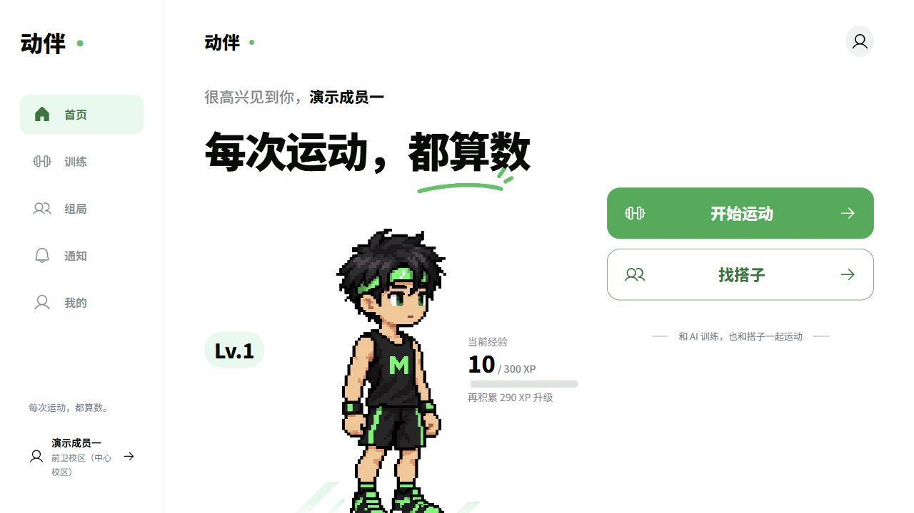
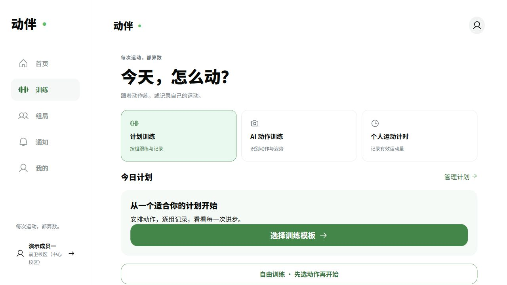

<div align="center">

# MoveMate · 动伴

**每次运动，都算数。**

把训练计划、AI 动作计数、语音陪练与找搭子，放进同一个运动社区。

[在线体验](https://dongban.xyz) · [开发指南](docs/development.md) · [文档中心](docs/README.md) · [反馈问题](https://github.com/xuzerui6/MoveMate/issues/new/choose)

[](https://github.com/xuzerui6/MoveMate/actions/workflows/ci.yml)


[](LICENSE)

</div>



## 产品能力

MoveMate 整合「动伴」的运动陪练、成长形象和「搭个局」的校园活动，使用统一账号、通知与数据库。手机保留五项底部导航，电脑使用侧栏与宽屏布局。

| 模块 | 可以做什么 |
| --- | --- |
| AI 动作训练 | 深蹲、开合跳、高抬腿、俯卧撑，本地姿态识别、完整动作计数、评分与纠错 |
| 计划与自由训练 | 动作库、可编辑模板、周计划／循环安排、逐组重量与次数、组间休息、暂停及刷新恢复 |
| 计划内摄像头 | 复用四种动作，并试用双臂弯举、侧平举、坐姿肩推、俯身划船、后撤弓步、双脚提踵 |
| 动作示范 | 图文步骤、同源分解帧、点击播放的视频、肌群展示；与摄像头能力分开标识 |
| 运动与成长 | 个人计时、训练历史、趋势、身体记录、XP、像素形象和装备；服务端确认结算 |
| 找搭子 | 发局、加入、聊天、通知、签到、到场确认、个人运动记录和活动统一结算 |
| 语音陪练 | 可选小智接入与设备池；未配置时使用本地文字反馈，不阻塞训练 |
| 数据工具 | 历史导入导出、计划草稿、进阶建议、配重计算、单位偏好与 PWA 只读缓存 |



截图来自演示账号的实际页面；截图不代表摄像头实拍质量验收。新动作识别为试用，评分用于反馈，不代表专业认证。

## 快速开始

推荐 **Node.js 24 + npm**；本机最低要求 Node.js 22.13，使用内置 `node:sqlite`。不需要另装 PostgreSQL、Redis 或 SQLite 服务。

```bash
git clone https://github.com/xuzerui6/MoveMate.git
cd MoveMate
```

**完整网页构建还需要站内专用素材。** 部分示范仅获准用于站内部署，不包含在 Git 中。先按[素材配置说明](docs/development.md#动作示范素材)设置 `MOVEMATE_MEDIA_DIR`；没有这些文件也可以完成公开源码测试和类型检查。构建不会自动下载、伪造或跳过授权素材。

Windows 配置好素材后，双击根目录 [`start-demo.bat`](start-demo.bat)，访问 [http://localhost:3001](http://localhost:3001)。脚本检查依赖、创建独立演示配置、构建并启动；失败即停止，不修改防火墙。

| 本机演示账号 | 用途 |
| --- | --- |
| `host@dajju.local` | 发起活动 |
| `player1@dajju.local` | 参加活动 |
| `player2@dajju.local` | 独立训练或第二个成员 |

密码首次启动随机生成，保存在被 Git 忽略的 `server/.env.demo`，启动时显示。重复启动不清空记录、不重置密码。演示数据库为 `server/data/demo.db`，与正式配置隔离；本机演示不依赖 SMTP。以上不是线上公开登录凭据。

跨平台手动启动、开发模式与环境变量见[开发指南](docs/development.md)。普通注册仍需校园邮箱验证码。

## 运行与架构

```text
浏览器 · React 18 / TypeScript / Vite / MediaPipe
   │ 同源 API、实时消息与可选语音
   ├─ 本机：Express + node:sqlite + Socket.IO
   └─ 云端：Cloudflare Worker + Static Assets
                 └─ SQLite-backed Durable Object
                    原生 WebSocket / Alarm / 持久化数据
```

生产入口为 [dongban.xyz](https://dongban.xyz)，采用 Cloudflare Workers 与 Durable Objects。当前使用免费方案，不自动开通付费资源；免费额度和网络状态会影响可用性。Vercel／Turso 为历史迁移方案，不是当前运行依赖。

- [架构与目录](docs/architecture.md)
- [Cloudflare 部署与回滚](docs/cloudflare-deployment.md)
- [训练规则与数据边界](docs/plan-training.md)
- [语音配置与学习演示限制](docs/shared-voice.md)

## 源码检查

```bash
npm ci --prefix server
npm ci --prefix client
npm ci --prefix cloudflare

npm test --prefix server
npm run test:repository --prefix client
npm run build --prefix server
npm run typecheck --prefix cloudflare
npm test --prefix cloudflare
```

GitHub Actions 使用 Node 24 检查后端、前端类型、Workers 与公开媒体。`test:repository` 校验所有示范元数据和仓库内媒体字节，不包含站内专用素材的真实文件检查。已配置素材的部署电脑应额外执行 `npm test --prefix client` 与完整构建。CI 不持有部署密钥，也不自动发布网站。

## 当前边界

- 动作库共 1,329 项，目前 **111 项有真人图片、10 项有原创图解、11 项有连续视频**；121 项完成图文对照，其余仍待核对或补齐。全库整理仍在进行，[实际覆盖、许可与未完成清单](docs/exercise-library-full-audit.md)。有示范不等于支持识别。
- 计划按有效运动每分钟 1 XP，摄像头不重复奖励；独立四动作训练按每次／对 2 XP。演示始终 0 XP，导入或补录不补发 XP。
- 摄像头在本地分析；视觉复核须单独授权。本站不保存原始音视频和完整陪练对话，上游服务另有其数据政策。
- 真实摄像头质量、BLE、语音有声结果按[实际验收记录](docs/README.md#验收记录)报告，不用回放冒充实拍。
- 小程序目录为历史样例，未纳入当前网页发布；离线缓存不提供新的正式运动计时。

## 参与与许可

欢迎通过 [Issue](https://github.com/xuzerui6/MoveMate/issues/new/choose) 描述问题或建议，通过 Pull Request 提交改进。请先阅读[贡献指南](CONTRIBUTING.md)；安全问题按[安全报告说明](SECURITY.md)处理，不要在公开 Issue 上传密钥、数据库、个人音视频或账号密码。

项目代码采用 [MIT](LICENSE)，字体、模型、动作数据、图片和视频遵循各自许可，**不统一按 MIT 再授权**。详见[第三方声明](DONGBAN_THIRD_PARTY_NOTICES.md)。

- 动伴原始前端与像素素材来自 [xuzerui6/dongban](https://github.com/xuzerui6/dongban)，引入版本保留于[实施记录](docs/implementation-notes.md)。
- 计划训练参考 [openGym](https://github.com/DuarteSantos8/openGym) 的功能组织并独立实现；没有复制其 AGPL 代码、翻译或受限媒体。
- 感谢 MediaPipe、MuscleMap、free-exercise-db、wger 及第三方声明中列出的项目与素材作者。
